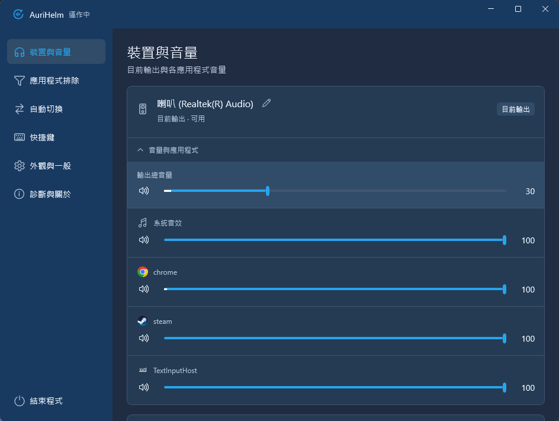
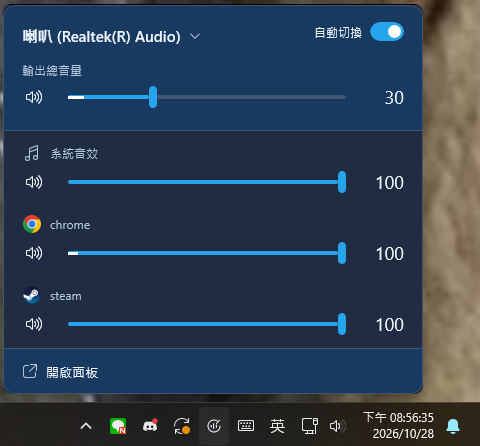
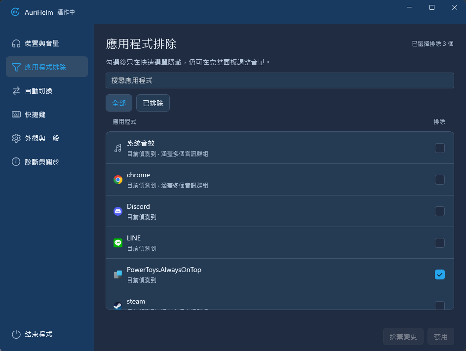
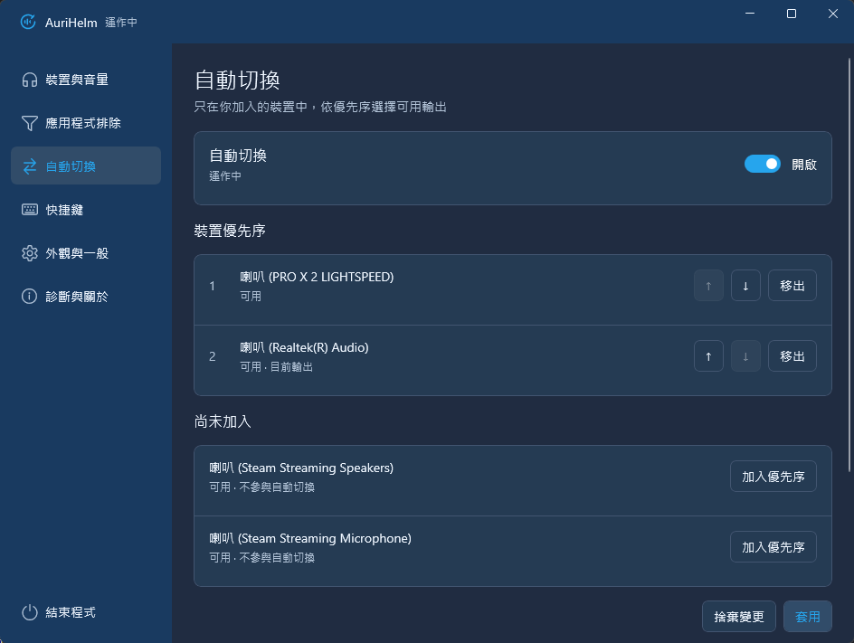

  

<h1 align="center">AuriHelm</h1>

從系統匣掌握 Windows 音量與音訊輸出。

  
  
  · <a href="https://github.com/kkldream/AuriHelm/actions/workflows/build.yml">建置與測試</a>

AuriHelm 是免費、開放原始碼的 Windows 音訊工具。快速調整各應用程式音量，整理常用輸出，並在耳機開關或裝置連線改變時，依你設定的優先序切換。

**目前版本：0.1.0-rc.5 候選測試版。** [下載 Windows 11 x64 安裝包](https://github.com/kkldream/AuriHelm/releases/download/v0.1.0-rc.5/AuriHelm-0.1.0-rc.5-win-x64-setup.exe) · [版本說明與 SHA-256](https://github.com/kkldream/AuriHelm/releases/tag/v0.1.0-rc.5)。安裝包未簽章，使用前請先閱讀下方限制；也可以依[貢獻指南](CONTRIBUTING.md#建置與測試)自行建置。

## 隨手調整，集中管理

在完整面板查看音訊裝置、總音量與各應用程式，常用控制集中在同一處。

## 從系統匣快速調整

不必打開完整設定，點一下系統匣就能調整目前輸出與應用程式音量。

  

## 讓常用聲音留在眼前

- **應用程式混音**：調整總音量、各應用程式音量及靜音；同一應用程式的多個音訊工作階段合併顯示，完整面板仍可展開個別明細。
- **應用程式排除**：將不常調整的應用程式從快速選單隱藏，完整面板仍保留控制。
- **輸出自動切換**：只在你加入的裝置中依優先序選擇可用輸出，新裝置不會自行加入。
- **PRO X 2 狀態**：顯示 Logitech PRO X 2 LIGHTSPEED 電源與可靠電量，配合耳機狀態切換輸出。
- **日常操作**：支援裝置別名、快捷鍵、繁體中文／英文，以及深色／淺色主題。

查看應用程式排除與自動切換設定

### 應用程式排除

搜尋應用程式並勾選排除，按「套用」保存。

### 自動切換

加入常用裝置、調整順序，再開啟自動切換。手動切換輸出會關閉自動，讓你的選擇優先。

## 開始使用

1. 啟動 AuriHelm，左鍵點系統匣圖示開啟快速選單。
2. 點裝置名稱可選擇輸出，拖曳滑桿調整音量，點喇叭圖示切換靜音。
3. 按底部「開啟面板」，或右鍵系統匣圖示選「開啟面板」，設定應用程式排除與裝置優先序。
4. 關閉面板後仍會在系統匣執行；要停止程式，請選「結束程式」。

## 系統需求與目前限制

- Windows 11 x64。Windows 10、ARM64 與其他耳機的私有電源／電量協定不在目前支援範圍。
- 一般輸出裝置透過 Windows 音訊端點管理；專用耳機狀態偵測目前限 PRO X 2 LIGHTSPEED。主要實機驗證組合為 PRO X 2 與 Realtek。
- 不提供麥克風管理、個別應用程式輸出路由或音效處理。
- 候選安裝包未簽章；程式內更新查詢尚未接上 Releases。乾淨作業系統部署、完整 DPI／多螢幕／鍵盤組合，以及睡眠喚醒與長時間常駐仍有待驗項目。
- RC.5 的 USB 通知競態修正已通過受控回歸與 CI，尚未實體拔插重測；本版完整安裝包的首次安裝、升級與啟動也尚未重做實機驗收。
- 候選版可能存在相容性問題，歡迎透過 [Issues](https://github.com/kkldream/AuriHelm/issues) 提供可重現步驟。

## 本機資料與隱私

設定與診斷日誌保存在 `%LOCALAPPDATA%/AudioOutputManager/`，不做遙測或自動上傳。診斷匯出會先預覽，由你選擇儲存位置。登入啟動由你在設定中選擇。

## 參與開發

建置、測試與提交流程請見 [CONTRIBUTING.md](CONTRIBUTING.md)，版本變更見 [CHANGELOG.md](CHANGELOG.md)，安全問題請依 [SECURITY.md](SECURITY.md) 通報。

## 授權

Copyright © 2026 Kerry (kkldream)。專案採 [MIT License](LICENSE)；第三方元件的著作權與授權另見 [THIRD-PARTY-NOTICES.md](THIRD-PARTY-NOTICES.md)。
